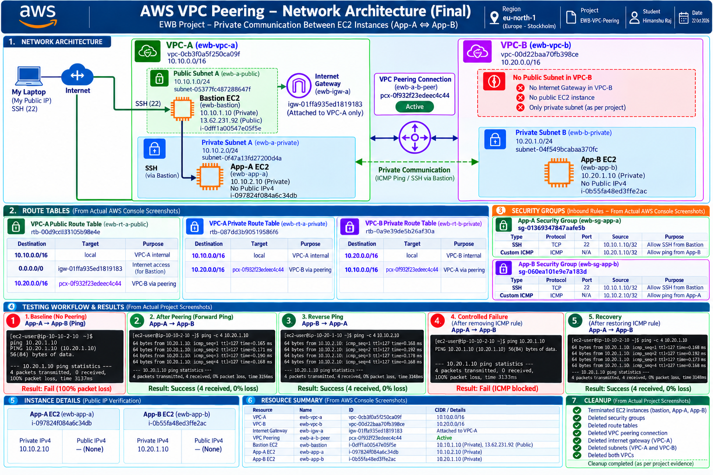
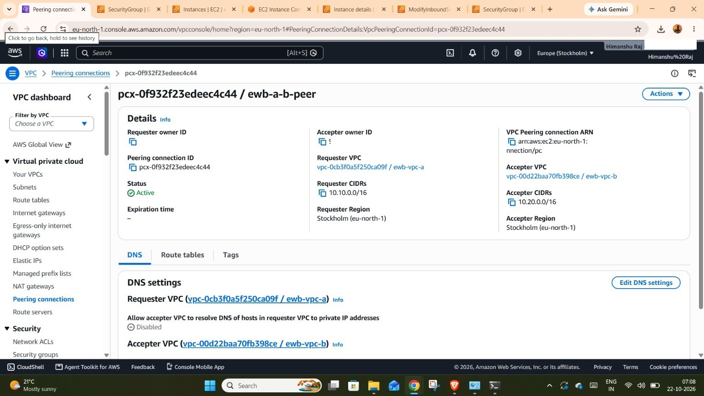
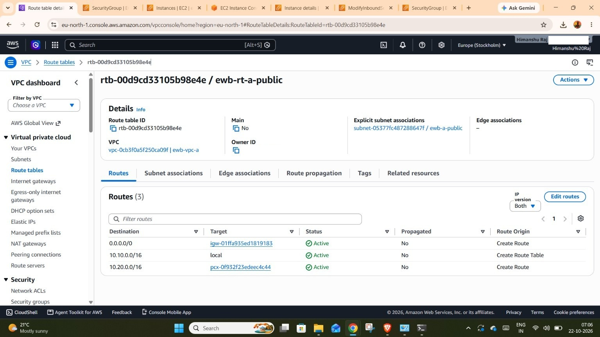
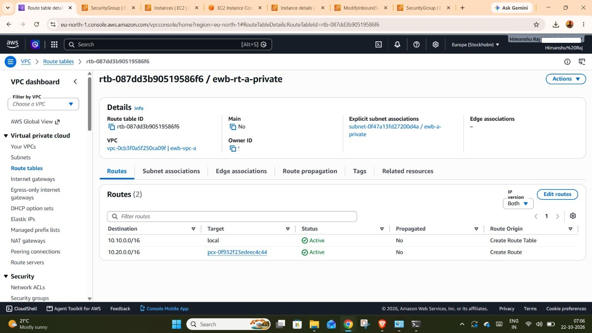
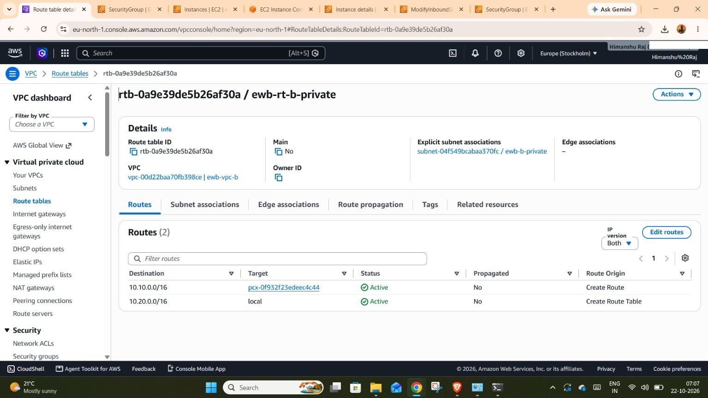
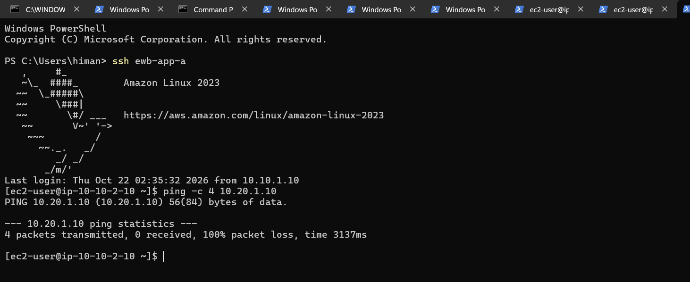
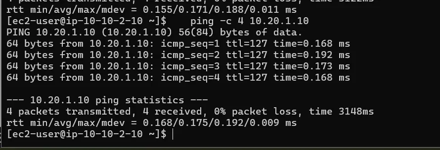
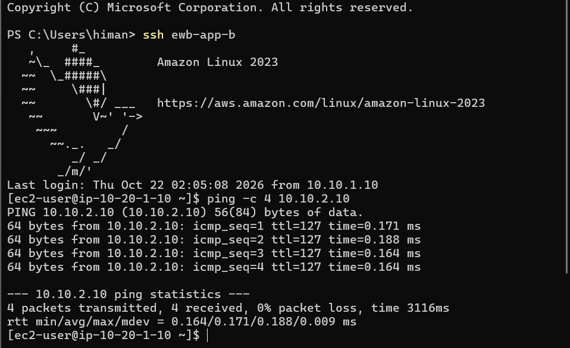
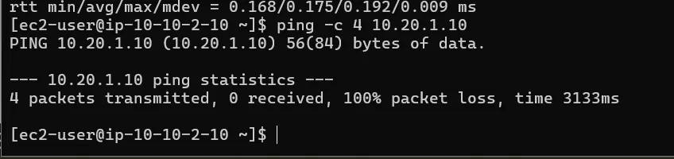
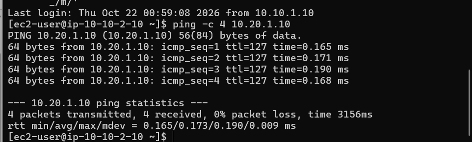

# AWS VPC Peering | EWB Cloud Lab Project

A hands-on AWS networking project demonstrating private communication between two Amazon Virtual Private Clouds (VPCs) using VPC Peering, route tables, security groups, and EC2 connectivity testing.

## Project Overview

This project implements VPC Peering between two VPCs in the AWS `eu-north-1` (Europe – Stockholm) region. The objective is to enable private communication between App-A and App-B using their private IP addresses, without assigning public IPv4 addresses to the application instances.

## Project Objectives

- Create and configure two separate VPCs.
- Configure public and private subnets according to the project design.
- Deploy a Bastion Host and two application EC2 instances.
- Create and activate a VPC Peering connection.
- Configure routes in the relevant route tables.
- Configure security group rules for SSH and ICMP traffic.
- Test connectivity before and after peering, including controlled failure and recovery.
- Document the architecture, implementation, verification, and cleanup evidence.

## AWS Services and Components

- Amazon VPC
- Amazon EC2
- VPC Peering
- Subnets and route tables
- Internet Gateway
- Security Groups
- SSH, ICMP, and Linux `ping` utilities

## Network Configuration

| Component | Configuration |
|---|---|
| AWS Region | `eu-north-1` |
| VPC-A | `ewb-vpc-a` — `10.10.0.0/16` |
| VPC-B | `ewb-vpc-b` — `10.20.0.0/16` |
| Public Subnet A | `10.10.1.0/24` |
| Private Subnet A | `10.10.2.0/24` |
| Private Subnet B | `10.20.1.0/24` |
| Bastion Host | `10.10.1.10` (private IP) |
| App-A | `10.10.2.10` (private IP) |
| App-B | `10.20.1.10` (private IP) |
| VPC Peering ID | `pcx-0f932f23edeec4c44` |

**Network design note:** VPC-B does not include a public subnet or Internet Gateway in this project design. App-A and App-B communicate using private IP addresses through VPC Peering.

## Architecture

The architecture connects VPC-A and VPC-B through a VPC Peering connection. Route tables provide routes to the remote VPC CIDR ranges. The Bastion Host provides the SSH jump-host path to the private instances, subject to the configured network and security group rules.

## Implementation Steps

1. Created VPC-A and VPC-B in `eu-north-1`.
2. Configured the public subnet and private subnet in VPC-A, and the private subnet in VPC-B.
3. Launched the Bastion Host, App-A, and App-B EC2 instances.
4. Created and accepted the VPC Peering connection.
5. Added the required peering routes to the relevant route tables.
6. Configured SSH and ICMP security group rules.
7. Tested connectivity between App-A and App-B.
8. Removed the relevant ICMP rule for a controlled failure test, then restored the rule and tested recovery.
9. Reviewed resource configuration and documented cleanup evidence.

## Verification and Testing

The following evidence highlights the key configuration and connectivity checks performed during the project.

### 1. VPC Peering Connection — Active

### 2. Route Table Configuration

**VPC-A Public Route Table**

**VPC-A Private Route Table**

**VPC-B Private Route Table**

### 3. Initial Connectivity Failure

### 4. Successful Connectivity — App-A to App-B

### 5. Successful Connectivity — App-B to App-A

### 6. Controlled Failure Test

### 7. Connectivity Recovery

## Project Documentation

- **Architecture Diagram:** [View Network Architecture](architecture/EWB_VPC_Peering_Architecture.png)
- **Final Report:** [Read the Project Report (PDF)](docs/HimanshuRaj_EWB_VPC_Peering_Final_Report.pdf)

## Cleanup

The project evidence includes cleanup activities involving EC2 instances, security groups, route tables, the VPC Peering connection, Internet Gateway, subnets, and VPCs.

Refer to the screenshots folder for recorded cleanup evidence. Resources should be considered deleted only where the final AWS Console evidence confirms deletion.

## Key Learnings

- AWS VPC and subnet design
- VPC Peering and CIDR-based routing
- Route table configuration
- Security group rules for SSH and ICMP
- Bastion Host and SSH jump-host access
- Private EC2 connectivity testing
- Controlled failure, recovery, and troubleshooting
- Cloud project documentation and resource cleanup

## Author

**Himanshu Raj**

GitHub: [HimanshuRaj02](https://github.com/HimanshuRaj02)

---

*Completed as a practical AWS cloud networking project.*

## All Project Screenshots

All configuration, connectivity testing, troubleshooting, SSH access, and cleanup evidence is available in the screenshots folder.

**[📁 View All Project Screenshots](screenshots/)**
